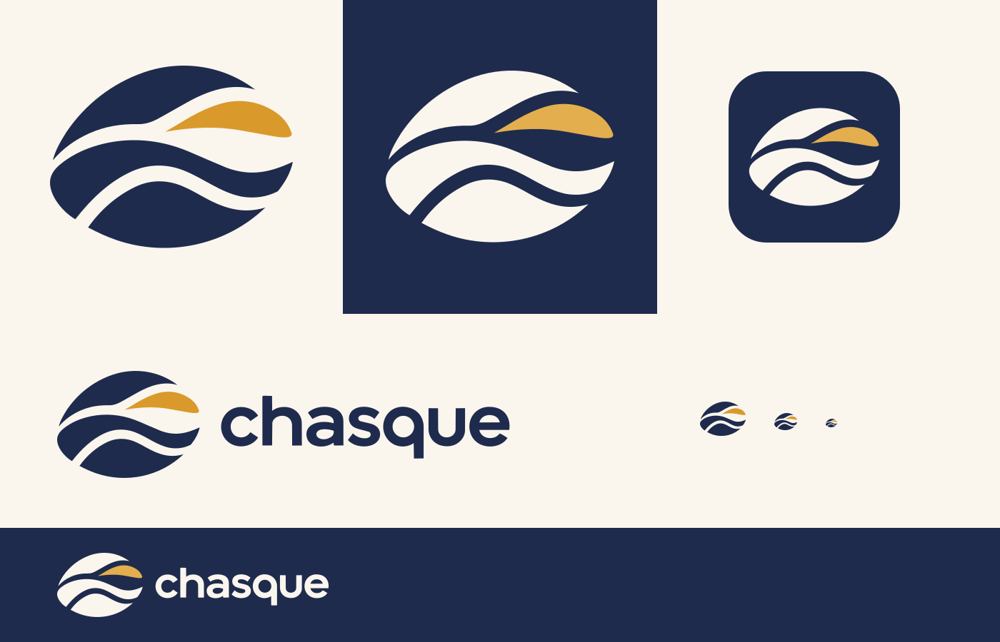

# Identidade do Chasque

Direção escolhida: **O mensageiro**. Estrada, recado, pampa.

O nome vem do chasque, o mensageiro a cavalo que levava recados entre as vilas do Sul. O app faz o mesmo:
leva o recado de cada lugar de que você gostou até a sua próxima viagem.

Frase de apoio: **O recado dos lugares que você gostou.**

## Missão, visão e valores (rascunho para a equipe validar)

**Missão.** Ajudar quem viaja a lembrar por que gostou de cada lugar e a escolher o próximo pelo próprio
gosto, levando cada visitante até os pequenos negócios que combinam com ele.

**Visão.** Ser a memória de viagem de quem roda pelo Sul do Brasil, começando pelo Vale do Taquari, e fazer
com que todo negócio local seja encontrado por quem tem o gosto que ele atende.

**Valores.**

1. **Seu gosto, não a média.** A sugestão nasce do seu histórico, não da nota de desconhecidos.
2. **A memória é sua.** Registros privados por padrão, exportação e exclusão a qualquer momento. Sem venda de dados.
3. **O local primeiro.** Pequeno negócio e cultura da região aparecem por afinidade, não por quem paga mais.
4. **Respeito ao tempo.** Registrar leva poucos toques; o app não pede o que não vai usar.
5. **Recomendação limpa.** Destaque pago é sempre identificado e nunca se passa por sugestão do seu perfil.

## Cores

| Nome | Hex | Uso |
|---|---|---|
| Noite | `#1F2B4D` | Cor principal: marca, botões, títulos |
| Ocre | `#D99A2B` | Destaque: pin do logo, selos, avisos de "combina com você". Texto sobre ele em Noite |
| Creme | `#FAF6EE` | Fundo das telas |
| Campo | `#4F7A4A` | Confirmação, natureza, sucesso |
| Tinta | `#1C2233` | Texto corrido |

No modo escuro: fundo `#111726`, superfícies `#1A2236`, texto `#F1ECE2`, principal `#A9B7E0`, destaque `#E3AE4E`.
Tokens em [`app/src/theme/variables.css`](../app/src/theme/variables.css).

Evitar o par vermelho e branco como cores de destaque: no Rio Grande do Sul eles remetem aos lenços
de maragatos e chimangos.

## Tipografia

- **Títulos:** Bricolage Grotesque (peso 600).
- **Texto e interface:** Figtree.
- As duas são livres (OFL) e vêm empacotadas no app (`@fontsource-variable`), sem chamar o Google Fonts.

## Tom de voz

Próximo e direto, como um amigo da região dando a dica. Frases curtas, verbo primeiro nos botões,
sem "por favor" nem exclamação em mensagem do sistema. Pode ter sotaque leve do Sul quando couber,
sem caricatura.

## Bordas e araucárias

Os cabeçalhos e a barra de abas são faixas Noite que terminam no desenho real da divisa do RS, tirado do
contorno do estado no OpenStreetMap (ODbL) e simplificado até virar uma linha de mapa:

- **Cabeçalho:** a divisa norte, nos rios Uruguai e Pelotas, na fronteira com Santa Catarina. Sobre ela ficam três
  araucárias na cor do vale (claras de dia, escuras à noite). Na Conta só aparece a borda, para não disputar
  com as iniciais.
- **Barra de abas:** um trecho mais a oeste da mesma divisa, de cabeça para baixo.

As araucárias são geradas por código (`marca/fonte/araucaria.py`): tronco que afina, galhos em candelabro
saindo de alturas diferentes e tufos de contorno irregular. Cada semente gera uma árvore diferente.
Para mudar o trecho, o tamanho ou as árvores, editar `marca/fonte/gerar_borda.py` e rodar
`python3 marca/fonte/gerar_borda.py`, que reescreve `BordaRS.vue` e `BordaAbas.vue`.

## Logo



**Ideia.** Um disco cortado por faixas onduladas: os morros do Vale do Taquari e o rio entre eles.
Entre as faixas de cima, o sol ocre se põe no horizonte, o próximo lugar. As pontas das faixas se abrem
à direita e desenham o C. É a paisagem por onde o chasque passava levando o recado.

O desenho original da equipe (Illustrator) fica em [`marca/original/`](../marca/original/). As versões abaixo
saem dele com as cores normalizadas para a paleta (Noite e Ocre) e sem metadados:

| Arquivo | Uso |
|---|---|
| `simbolo.svg` | Símbolo sobre fundo claro |
| `simbolo-claro.svg` | Símbolo sobre fundo Noite ou escuro |
| `chasque-horizontal.svg`, `chasque-horizontal-claro.svg` | Símbolo e nome lado a lado |
| `chasque-nome.svg`, `chasque-nome-claro.svg` | Só o nome |

Ícones do app (PWA, Android, iOS e favicon) em `app/public/icones/`.

**Regras de uso**
- Área de respiro em volta do símbolo: no mínimo a altura do sol.
- Não girar, não aplicar sombra ou degradê, não trocar o ocre do sol por outra cor.
- Em uma cor só: Noite sobre Creme ou Creme sobre Noite, com o sol na mesma cor do disco.
- Abaixo de 24 px o sol perde leitura; no favicon isso é aceitável.

**Gerar de novo.** Depois de alterar os arquivos em `marca/original/`, rodar no container de ferramentas
(`rsvg-convert`, `fonttools` e `pillow`):

```bash
python marca/fonte/limpar_svg.py marca
python marca/fonte/gerar_icones.py marca app/public/icones
python marca/fonte/apresentacao.py marca app/public/icones
```

Depois copiar `simbolo*.svg` e `chasque-horizontal*.svg` para `app/public/marca/`.
